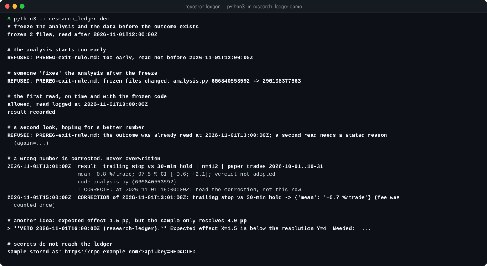

# research-ledger

[](LICENSE)  

An append-only log of results and decisions, and preregistrations that freeze the code and data before the outcome
exists and let the outcome be read once. For anyone testing trading ideas, A/B tests or any analysis where it is
easy to keep looking until the number looks good.

<p align="center"></p>

The demo runs in a temporary folder on made-up numbers: `python3 -m research_ledger demo`.

## Why

Three ways a research process lies, each of which happened to me:

1. **The number lives only in a chat.** A week later nobody can find it, so the question is asked again and gets a
   different answer. → Every result is a row in one file that is only ever appended to, with the hash of the code
   that produced it. `find` answers "was this measured before?" in one line.
2. **The analysis is "fixed" after seeing the data.** Drop the worst day, change the threshold, read again.
   → `freeze` stores sha256 of the analysis code and inputs before the outcome exists. `gate` refuses to run if any
   of them changed.
3. **The second look.** The first read was disappointing, so it is read again, later, with more data.
   → `gate` allows one read after the agreed time; another read needs a stated reason, and that reason is logged.

Two more rules that a text file cannot enforce:

- **Corrections never overwrite.** A wrong number gets a correction row that points at it. The original stays and is
  flagged every time it is found: "read the correction, not this row".
- **Vetoes are mechanical.** If the effect you expect (X) is smaller than the smallest effect the sample can tell
  from zero (Y), the question cannot be answered with this instrument. `veto` puts a banner on top of the
  preregistration, and `gate` refuses to read it. The number decides, not the person who calls it.

## Use it in an analysis script

```python
from research_ledger import gate, record

gate("PREREG-trailing-stop.md")   # raises GateRefused: too early / code or data changed / already read / closed

mean, lo, hi, n = analyse("trades.csv")
record("trailing stop vs 30-min hold", "paper trades 2026-10-01..10-31", n,
       {"mean": f"{mean:+.2f} %/trade", "97.5 % CI": f"[{lo:+.2f}; {hi:+.2f}]"}, code_file=__file__)
```

## Command line

```bash
python3 -m research_ledger freeze PREREG.md analysis.py trades.csv --read-after 2026-11-01T12:00Z
python3 -m research_ledger verify PREREG.md          # exit 1 if a frozen file changed
python3 -m research_ledger gate PREREG.md            # exit 2 if the read is not allowed
python3 -m research_ledger record "latency p50" --sample "rpc A, 1 h" --n 600 --result "p50=120 ms" --code bench.py
python3 -m research_ledger find latency              # every row that mentions it, corrections flagged
python3 -m research_ledger last 10
python3 -m research_ledger correct 2026-11-01T13:01:00Z "latency p50" --result "p50=118 ms" --why "warm-up included"
python3 -m research_ledger veto PREREG.md --x 1.5 --y 4.0 --need "~2,900 trades"
python3 -m research_ledger replace PREREG.md --by PREREG-v2.md --why "the data source changed"
python3 -m research_ledger note "stop live trading" --why "the edge is gone by the closing rule"
```

The ledger is `./LEDGER.jsonl`, or the file in `$RESEARCH_LEDGER`.

## Secrets do not reach the file

Research notes collect URLs and configs, and those carry keys. Before a row is written, every string is cleaned:
API keys in URLs and key-like fields (`api_key`, `token`, `secret`, `password`, `private_key`), UUIDs, JSON byte
arrays of a keypair, and base58 strings of 64+ characters (a private key). Then any string that still contains
`api-key=` is replaced as a whole. Transaction signatures are as long as private keys, so `record(..., base58=False)`
keeps them.

## Where it comes from

I built this discipline for my own Solana trading system: 27 preregistered experiments and 180+ recorded results,
most of them negative. The ledger is what let me say "this was tested on 20 Sept and failed" instead of testing it
again. It pairs with [honest-backtest](https://github.com/hrekokovgmmek-lab/honest-backtest), which checks whether a
backtest result is real; this repository keeps the record of what was asked and when.

## Tests

```bash
python3 -m unittest discover -s tests
```

20 tests: appending and hashing, redaction and the final seal, corrections, broken lines reported instead of
skipped, the freeze table, every refusal of the gate, one read and a reasoned second read, veto, replace, the CLI
exit codes, and a demo that leaves no files behind.

## License

MIT
